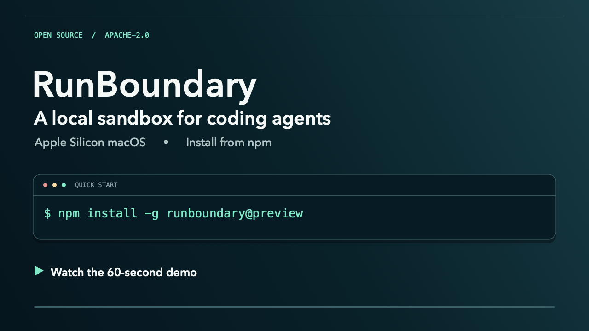

# RunBoundary

A Rust CLI that launches coding agents in a mandatory OS sandbox with a copied, filtered project workspace. Apache-2.0 licensed.

RunBoundary excludes sensitive project paths before copying files and keeps the original project outside the agent’s approved filesystem access. It never falls back to an unsandboxed launch. Filename patterns decide what is copied; Linux namespaces or macOS Seatbelt rules enforce the configured filesystem boundary. The macOS backend does not provide Linux namespace isolation.

## 60-second demo

[](docs/media/runboundary-demo.mp4)

See how to install RunBoundary on an Apple Silicon Mac, run in a filtered copy,
and review an edit before applying it to the original project.

## Release status

| Platform | Status |
| --- | --- |
| macOS (Apple Silicon) | [Version 0.1.0 preview on npm](https://www.npmjs.com/package/runboundary/v/0.1.0). |
| Linux | Coming soon. The Bubblewrap backend is available for development from source. |
| Windows | Coming soon. Path validation is implemented, and the native sandbox is in development. |

The macOS preview covers npm tarball installation, policy initialization,
Seatbelt checks, isolated runs, retained previews, terminal diffs, explicit
apply, and journaled recovery. The latest core validation on macOS 26.5.1 arm64
passed all 21 native Seatbelt tests, four workflow tests, four preview tests,
and one toolchain test. Full live-agent validation and independent security
review are still open. See the [release checklist](docs/macos-release.md).

**Browser review** is in development on the [`webreview` branch](https://github.com/GopalNagamani/agentvault/tree/webreview).
Use `runb diff SESSION` for review in the macOS preview. `runb preview SESSION`
runs a command against retained changes, including web app tests.

**Secret handling** keeps protected paths such as `.env` files and private keys
out of the copied workspace. Terminal diffs also redact common credential-like
text heuristically. Review redaction affects displayed output. Keep secrets out
of source files that the agent is allowed to read. See the [security model](SECURITY.md).

## Native macOS (experimental)

Install the preview with:

```sh
npm install -g runboundary@preview
```

Run `bash scripts/test-macos.sh --runtime-root /opt/homebrew` from Terminal to
reproduce the checks without a VM. This explicitly approves Homebrew reads
for the test runtimes. See the [native macOS guide](docs/macos.md) for setup,
limitations and shell/agent examples, and [validation evidence](docs/validation.md).
`init` selects `seatbelt` on macOS and `bubblewrap` on Linux; a mismatched
existing configuration is refused.

## Linux prerequisites and installation

Use an unprivileged Linux account, Linux 5.11+ (including close_range with CLOEXEC support), enabled unprivileged user namespaces, Bubblewrap 0.8+ with --disable-userns support, and a Rust stable toolchain. Distribution security policies such as AppArmor may disallow user namespaces even when kernel support exists. The real startup probe is authoritative; missing support refuses launch.

On a suitable Debian/Ubuntu host:

```sh
sudo apt-get install bubblewrap build-essential pkg-config python3 nodejs
cargo build --release --locked
# Optional: install the CLI, not the agents, as an administrator-managed executable.
sudo install -m 0755 target/release/runb /usr/local/bin/runb
```

Install Codex or Claude Code and their complete runtime dependencies in root-owned, non-group/world-writable system runtime directories under /usr, typically /usr/local. User-home, nvm, Homebrew, ~/.cargo, ~/.local, and native agent installations stored under the host home are deliberately unsupported. An npm launcher resolving into /usr/local/lib/node_modules is compatible with the mount layout; live version compatibility still needs testing. The executable and every resolved ancestor must be root-owned and have no setuid/setgid or group/other write bits. Do not run RunBoundary using sudo.

The Rust CLI uses **clap**, since Cobra is a Go library. Cargo.toml is the Rust package manifest. No rs.mod file or Go wrapper is needed.

## Usage

RunBoundary does not require a model API key. Authentication belongs to the
agent and its selected provider. Local or self-hosted models without
authentication can run without credential flags; explicitly approved API keys
and file-backed ChatGPT login are optional integrations. Host login caches and
configuration are never imported automatically.

To use the command name `runb` directly, install it once from this
repository (no sudo):

```sh
cargo install --path . --locked
```

Ensure Cargo's installation directory (normally `$HOME/.cargo/bin`) is on your
shell's PATH. Then run commands from your original project's directory:

```sh
cd "/path/to/your/project"
runb init
runb doctor sh
runb run sh
```

When a run retains changes, use the session ID it prints:

```sh
runb preview SESSION_ID npm test
runb diff SESSION_ID
runb apply SESSION_ID
```

`diff` shows changes. `apply` explicitly approves the session and closes its
pending review record. Use `--project PATH` to work from another directory.
For `run` and `preview`, put RunBoundary options before the executable name.
Arguments after the executable go to that command.

`init` detects protected path names without opening their contents. It refuses to overwrite an existing configuration; remove or edit it explicitly. The current directory is the project root unless `--project /absolute/path` is supplied. The configuration must exist in that selected directory.

Doctor checks actual sandbox startup and local filesystem isolation before reporting success. A credential-presence check does **not** verify provider login or complete agent compatibility. `run` can also launch a trusted system executable for diagnostics, e.g. `runb run sh`. No host PATH search, host home mounting, automatic login-directory mounting, or unsandboxed compatibility fallback is provided.

Agent terminal input/output is inherited, restricted to terminals, pipes, and /dev/null. Regular-file or socket standard streams are refused; use a pipe and `tee` for log redirection. Namespace/session and signal behavior must be tested with the particular agent version before relying on interactive workflows. Host authentication is never imported automatically. Use the explicit authentication option for [your agent](#connect-an-agent). These credentials are visible to the agent and its descendants for the duration of the session and may be transmitted or written by them. Do not approve production application secrets.

For new files missing from an Xcode navigator, see [Xcode file registration](docs/xcode-files.md).

For experimental compilation of a single retained XIB in a separate compiler
sandbox, see [the XIB broker](docs/xib-broker.md). Full iOS builds remain unverified.
The experimental [`ios-build` command](docs/ios-build.md) now provides typed
`IBC_EXEC` routing for unsigned Simulator builds; native integration validation
is still required.

## Connect an agent

Install the agent in a runtime RunBoundary can access. On macOS, for an agent
installed under Homebrew, initialize the project with
`runb init --runtime-root /opt/homebrew` on Apple Silicon. For an existing
project, add that path to `sandbox.runtime_roots` in `runboundary.yaml`.
On Linux, use a trusted system runtime such as `/usr/local`.

From the initialized project's directory, choose the launch command for your agent:

| Agent | Setup | Launch |
| --- | --- | --- |
| Codex with ChatGPT | Sign in to Codex with a [file-backed login](#codex-with-your-chatgpt-login). | `runb run --chatgpt codex` |
| Codex with an API key | Set `OPENAI_API_KEY` in your environment. | `runb run --auth-env OPENAI_API_KEY codex` |
| Claude Code | Set `ANTHROPIC_API_KEY` in your environment. | `runb run --auth-env ANTHROPIC_API_KEY claude` |
| Freebuff | Sign in normally, then approve its profile with `runb auth setup freebuff`. | `runb run freebuff` |
| Hermes with Nous Portal | Sign in and [install an approved runtime](docs/auth-adapters.md#dedicated-hermes-runtime-on-macos), then run `runb auth setup hermes`. | `runb run hermes` |
| Other agents | Follow the agent's own setup. For a file-backed login, save a [custom adapter](docs/auth-adapters.md) with `runb auth setup AGENT --adapter PATH`. | `runb run AGENT` |

To check the local sandbox, executable, and selected credential source, replace
`run` with `doctor` in the launch command. For saved approvals, use
`runb auth remove AGENT` to revoke access. A live session verifies provider login.

### Codex with your ChatGPT login

From a project initialized with `runb init`, explicitly approve the file-backed
Codex login at `$HOME/.codex/auth.json`:

```sh
runb doctor --chatgpt
runb run --chatgpt codex
```

Use `--codex-auth-file PATH` for a different login file. If your Codex version
needs the terminal compatibility options, pass them after `codex`:

```sh
runb run --chatgpt codex --no-daemon --no-alt-screen \
  --sandbox danger-full-access --ask-for-approval on-request
```

In that example, RunBoundary enforces the OS sandbox while Codex skips its own
nested sandbox. Choose one authentication option per invocation.

This imports only ChatGPT tokens/account information into a disposable, private
Codex home. It does not import host settings, sessions, plugins, or the Keychain.
The approved access, ID and refresh tokens **are readable by the agent and its
subprocesses**, which have network access. Never publish the login file.
The source must be an absolute, current-user-owned, single-linked regular file
with private permissions (`chmod 600`); symlinks in the path are refused.
Keychain-only logins are unsupported: use a separate file-backed login with
`codex -c 'cli_auth_credentials_store="file"' login` if needed. Never print the file.

Refreshed credentials are not written back to the host and are discarded at
session cleanup. OAuth refresh-token rotation can invalidate the original login;
you may need to log in again, and should avoid concurrent sessions sharing the
same refresh token. A fresh login does not bypass ChatGPT usage limits.
This follows Codex's documented file-backed authentication mechanism:
https://learn.chatgpt.com/docs/auth. Live ChatGPT inference must still be verified
in your Terminal; synthetic credential tests do not certify account access.

For an already-running local Ollama server with a compatible model installed:

```sh
runb run codex --oss --local-provider ollama -m YOUR_LOCAL_MODEL \
  --sandbox danger-full-access --ask-for-approval on-request
```

No provider key is required by RunBoundary. Codex's own sandbox is disabled in
this example because RunBoundary supplies the mandatory outer OS sandbox.
The agent executable still needs an approved runtime installation. Localhost
TCP connections are allowed; run the model server outside the sandbox so its
model files do not need to be exposed. Host Codex settings remain excluded;
pass provider settings through the agent's supported CLI options. A self-hosted
endpoint that requires credentials still needs explicit credential provisioning.
The current `--auth-env` integration supports only the two named provider keys;
it does not yet support arbitrary self-hosted credential variables. Local model
inference must be verified in a real session.

## Edit the project policy

Run `runb init` once from the project root to create `runboundary.yaml`. Open
it in your editor, for example with `nano runboundary.yaml`, and save your
changes there.

To keep a project folder out of the agent's workspace, append its path or glob to
the existing `filesystem.protected` list. Add `- "private"` at the same indentation
as the other list items to exclude a top-level `private` directory and its contents.
RunBoundary enforces its built-in protected patterns independently of this list.

After saving, run `runb doctor sh` to validate the policy and check sandbox
startup. See the [configuration reference](docs/configuration.md) for supported
fields, runtime roots, and path matching rules.

## Reviewing and applying edits

By default the original project is unchanged. Changed workspaces are retained under a private temporary parent; RunBoundary prints a session identifier:

```sh
runb diff SESSION
runb apply SESSION
```

Review diffs print only permitted files; text lines are escaped to prevent terminal control injection. They heuristically redact common credential assignments, token formats and private-key blocks, and review/run summaries warn when likely credentials are found. This affects display only: the agent can still read permitted source content, and detection may miss secrets or flag examples. Binary and large file previews are summarized. The developer must review the code, not only filenames, before approval. `--apply` is explicit developer approval; it does not imply that generated code is safe.

For advance approval of a session, use `runb run --apply --auth-env OPENAI_API_KEY codex`. It summarizes changes and applies only after a zero exit code. Prefer the two-step review workflow. Approval is never inferred from agent output. Unsafe/protected outputs reject synchronization. Host changes since preparation cause refusal. No Git repository is required.

Application retains original files and a durable journal under `.runboundary-recovery-*`. It attempts rollback on synchronous failure, but multi-file application is not globally atomic. Use `runb recover` after an interrupted apply; unexpected later edits can still require manual recovery. Read [recovery instructions](docs/recovery.md). After review, explicitly remove retained temporary workspaces, review records, and recovery directories you no longer need; they can contain sensitive permitted source code. Unchanged workspaces are cleaned up automatically. Agent edits to empty directories, directory modes, and metadata other than the owner executable bit are not synchronized.

## Security model and limitations

Read [SECURITY.md](SECURITY.md) and the platform-specific [macOS guide](docs/macos.md) before use, along with [architecture](docs/architecture.md), [configuration](docs/configuration.md), and [validation status](docs/validation.md).

On Linux, the system-runtime mounts expose their full read-only contents. They must not contain secrets or projects; /usr/local is not assumed to be secret-free merely because it is a runtime directory. Projects overlapping exposed runtime directories are refused. Home-installed agents are not supported by weakening this rule.

RunBoundary cannot protect secrets already present in permitted source files, allowed environment variables, model prompts, or approved authentication credentials. Networking is enabled and unrestricted, including reachable host services: an agent can transmit everything it can legitimately read. This is not network DLP. The kernel, host administrator, same-UID host processes, runtime installations, and the developer approving changes must be trusted.

## Tests

On a Mac with Multipass installed, use the [automated Linux VM test guide](docs/multipass.md): `bash scripts/test-multipass.sh`. It copies only the build/test source and writes reports to `test-results/`.

For the manual Linux smoke test, use [Codex with ChatGPT sign-in](docs/multipass.md#live-codex-smoke-test-with-chatgpt-sign-in) to verify authentication, project edits, review, and apply. This workflow requires a ChatGPT account with Codex access.

Portable tests, formatting, and lint checks:

```sh
cargo fmt --check
cargo test --locked
cargo clippy --all-targets --locked -- -D warnings
```

Real security integration tests are explicitly ignored by default and show their prerequisites. On a supported **unprivileged Linux** host with Bubblewrap, Python 3, Node.js, and system shell runtimes:

```sh
cargo test --locked -- --ignored --nocapture --test-threads=1
```

These ignored tests actually invoke Bubblewrap; they do not mock filesystem permissions. Explicitly running them on an unsupported host fails with a prerequisite error rather than reporting false success. The normal test command does not establish Linux security guarantees. Kernel restrictions inside Docker/CI can prevent tests; use a Linux VM with the required namespace support. The supplied CI workflow runs the real suite and fails when isolation is unavailable; it does not weaken host policy automatically.

No Codex or Claude Code version is currently certified. See the [version validation matrix](docs/validation.md) and record exact agent, kernel, and Bubblewrap versions when testing. External independent review and successful adversarial Linux tests are release gates.

## Test retained changes before approval

Use the session ID printed after the agent exits. Preview runs the edited copy;
it does not update your original project or approve changes:

```sh
runb preview SESSION_ID npm test
runb preview SESSION_ID --allow-network-listen \
  npm run dev -- --host 127.0.0.1 --port 5173 --strictPort
```

Open `http://127.0.0.1:5173` once the app reports that it is listening.
`--allow-network-listen` explicitly approves TCP server sockets on macOS; without
it, preview denies TCP bind/inbound operations. **Seatbelt cannot reliably
restrict inbound listeners to loopback or selected ports.** A server binding
`0.0.0.0`, `::` or another interface can be reachable from your network. The app's
`--host 127.0.0.1` setting is a convention, not an enforced security boundary.
`--port` is repeatable and prints an expected URL only; it is not a firewall rule
and requires `--allow-network-listen` so an old invocation cannot silently opt in.

Linux uses the existing shared host network: neither this flag's absence nor
`--port` restricts listening ports there. Configure your app for loopback.
RunBoundary does not automatically open a browser or certify that a server is
ready. The server's own terminal output reports its startup result.

For a simple Python project, run:

```sh
runb preview SESSION_ID --allow-network-listen \
  python3 -m http.server 8000 --bind 127.0.0.1
```

On macOS, use `python3.12` from the approved Homebrew runtime instead of
`python3` if the latter selects Apple’s Xcode launcher. The native test suite
requires the same standalone Python 3.12 runtime.

Stop the foreground server with Ctrl-C. Then review and approve:

```sh
runb diff SESSION_ID
runb apply SESSION_ID
```

Each preview uses the configured OS sandbox and a fresh private home/temp with
no imported agent credentials, host `.env`, SSH agent or host dependency cache.
Commands are resolved from approved runtimes. Existing permitted workspace files
remain visible. Preview can modify code and create build artifacts; all such
changes are rescanned and included in the next review. The original session
baseline remains unchanged. Exit codes are preserved; a failing test never
approves or applies files. Review/apply and another preview of that session are
refused while the preview command is active.

Dependencies and tools must be available inside the sandbox. RunBoundary does not
install dependencies automatically. Relative links such as
`node_modules/.bin/acorn -> ../acorn/bin/acorn` are supported when they point
directly to a permitted regular file also copied into the workspace. The copier
reads link text without following it and recreates the link only after copying
its target. Absolute links, outside/secret targets, directory links, link chains,
special files and hard links remain rejected. Size/file-count limits still apply.
Consequently pnpm/workspace directory-link layouts and some builds remain
unsupported.
No exception is made to these checks for preview. An unsafe output remains
unapplied; repair or discard that session before retrying. After an abrupt crash,
stale `sandbox-home`/`sandbox-tmp` siblings can cause a fail-closed startup refusal;
discard that session and start a fresh one rather than reusing unknown state.

### CLI, library, backend and mobile toolchains

`preview` also runs tests, compilers and executable project scripts such as
`./gradlew` and `./mvnw`. Optional `toolchains` entries explicitly approve
read-only Rust/Go/JDK/Android SDK/Xcode roots; caches remain private. Use
`runb tools --check` for actual sandboxed executable version checks.
See [toolchain configuration and project examples](docs/toolchains.md).
SDK exposure is implemented; full Android/iOS builds, emulator/Simulator,
USB/device, GUI and release-signing workflows have not been certified or
integrated. These commands never automatically expose host homes or credentials.
